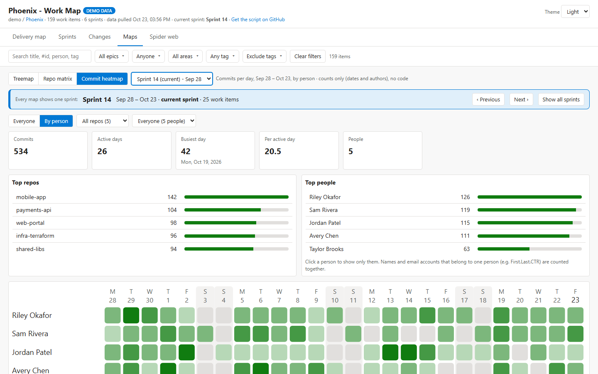

# ADO Work Map for Azure DevOps

**An Azure DevOps extension: your whole project at a glance, and sprint planning as a team, right inside Boards.**

### [&#9654; Try the live demo](https://dascondor.github.io/ado-work-map-extension/) &nbsp;&middot;&nbsp; [Sprint planning demo](https://dascondor.github.io/ado-work-map-extension/sprint-planning.html)

Split from <a href="https://github.com/DasCondor/ado-work-map">ado-work-map</a> (the PowerShell script and VS Code extension), keeping its history. This repo is the Azure DevOps extension only. The live demo uses sample data, not a real project.

---

## Latest updates

### 1.2.0 &mdash; Sprint planning is a real hub

**Boards > Sprint planning** now works on your project, next to the Work Map:

- **Reads** the team's sprints, members, capacity per day and days off (plus team days off), and the work items &mdash; with points, remaining work, description and acceptance criteria.
- **Partial days off** (half a day, a few hours), which Azure DevOps can't store, are kept in the extension's own data storage for the team, so everyone sees them.
- **Save plan** writes the plan back: stories' sprint, owner and points; the new **Validation** / **Assisting team member** tasks, linked to their stories; and capacity and days off. It shows what will change first, never overwrites a story someone else changed meanwhile, and keeps anything that didn't save so you can try again.
- **Open in Azure DevOps** opens the real work item form from the planning view.
- New permission: **Work items (read & write)**, used only by Save plan. The Work Map still only reads.

### Split into its own repo

- The Azure DevOps extension now lives here, with its history from ado-work-map. The PowerShell script and VS Code extension stay in [ado-work-map](https://github.com/DasCondor/ado-work-map).
- The live demo shows both hubs under **Boards** in an Azure DevOps-style frame, with a collapsible side panel; switching between them happens in place.
- **Sprint planning** is a preview hub (demo only so far). Next: a real hub that reads your sprints and team capacity and can **save the plan back** to Azure DevOps.

## The hubs

### Work Map

Epics, features, stories and tasks, every sprint, what changed, and how the work connects to your code.

- **Delivery map** &mdash; epic &rarr; task with accomplished / in progress / not started roll-ups and progress over time.
- **Sprints** &mdash; every sprint on a timeline, sprint detail, velocity and a sprint map.
- **Changes** &mdash; what was created, completed, updated or moved in any time frame, and a change log between visits.
- **Maps** &mdash; treemap, repo matrix and a commit heatmap (everyone or by person, any sprint), each narrowable to one sprint.
- **Spider web** &mdash; work items and their links, with the PRs, commits, branches, builds and repos attached.

<table>
<tr>
<td width="50%"> <b>Spider web</b></td>
<td width="50%"> <b>Commit heatmap</b> by person, for a sprint</td>
</tr>
</table>

### Sprint planning

Sprint planning run as a guided team meeting on your real sprints and work items: capacity check-in (hours per day, full / half / partial days off, team holidays, 1&ndash;5 week sprints), carry over, planning poker with the full story in a work item form, people lanes or swimlanes with assigned work against capacity, quick **Validation** and **Assisting team member** tasks, a sprint calendar with a capacity burn-up, and a confidence vote.

It reads the team's capacity and days off from Azure DevOps and **Save plan** writes the plan back (sprint, owner and points of stories, new tasks, capacity and days off). The [live demo](https://dascondor.github.io/ado-work-map-extension/sprint-planning.html) runs the same page on sample data.

## Install

The extension is published privately on the Visual Studio Marketplace and shared with organizations on request. An organization admin installs it from **Organization settings > Extensions > Shared**, and it appears as **Boards > Work Map** in every project.

To publish it under your own publisher: change `publisher` in `azure-devops-extension/vss-extension.json`, build it (below), and upload the `.vsix` at [marketplace.visualstudio.com/manage](https://marketplace.visualstudio.com/manage).

**Permissions:** Work items (read & write), Code, Project and team, Analytics (read). Only **Save plan** in Sprint planning writes &mdash; stories' sprint, owner and points, new tasks, and team capacity and days off; the Work Map only reads. It reads PR metadata and commit dates and authors &mdash; never file contents or diffs &mdash; and there's no server behind it: data stays in Azure DevOps and the user's browser.

Azure DevOps Services only (not Azure DevOps Server).

## Build

| What | Command | Needs |
|---|---|---|
| Extension `.vsix` | `powershell -ExecutionPolicy Bypass -File azure-devops-extension\build.ps1` | [tfx-cli](https://www.npmjs.com/package/tfx-cli) (`npm install -g tfx-cli`) |
| Live demo (`docs/`) | `powershell -ExecutionPolicy Bypass -File demo-site\build.ps1` | Windows PowerShell 5.1 |

## What's where

| Folder | |
|---|---|
| `azure-devops-extension/` | The extension: manifest, hub code (`src/hub.js`), bundled Azure DevOps SDK (MIT), Marketplace overview and build |
| `sprint-planning/` | The Sprint planning hub (preview) and its build |
| `demo-site/` | The live demo frame and the build for `docs/` |
| `docs/` | The GitHub Pages live demo (built files) and README images |
| `report/` | The shared report engine (`ado_work_map.ps1`) the hub and demo are built from &mdash; see [report/README.md](report/README.md) |

## Security and privacy

- Reads with the signed-in person's own access, and writes only when someone clicks **Save plan** &mdash; after showing what will change, and never over a story someone else changed meanwhile.
- Work item text (descriptions, acceptance criteria) is cleaned before it's shown: only plain formatting and `https` links are kept.
- No server, no telemetry, no outside scripts: the Azure DevOps SDK is bundled, and the live demo pages run under a strict content security policy that blocks loading or sending anything.
- Not affiliated with Microsoft.

## License

[MIT](LICENSE)
