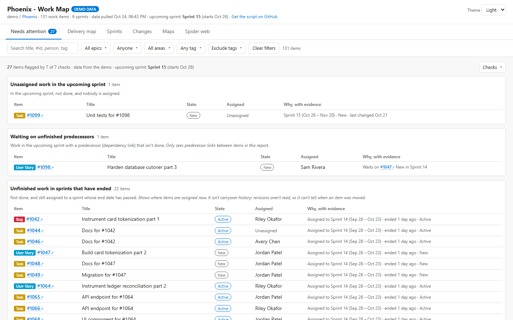

# Updates

Every release of ADO Work Map for Azure DevOps, newest first. Back to the [README](README.md).

### 1.6.1 &mdash; preview: swim lanes in every check

- **Needs attention:** every finding notes the swim lane (e.g. **BA Review lane**) and the step of its status flow; a task shows its story's lane and step.
- **Waiting on unfinished predecessors:** a predecessor in a swim lane is tagged with it too.
- **Summary line:** counts the flagged items in each lane (e.g. "4 in the BA Review lane").

### 1.6.0 &mdash; preview: status flows, swim lanes, settings

- **Settings tab** in the Work Map:
  - **Status flows:** the steps your stories go through (e.g. New > Ready > In Progress > Review > Resolved), by area path, iteration and/or swim lane. A step matches the board column, or else the state.
  - **Planning data the maps use:** turn Swim lane, Start Date and End Date on or off, and pick the date fields.
  - **UAT and stuck work:** the UAT swim lane (default BA Review), the UAT task title, and how many days in one step counts as stuck.
  - Saved for the whole project in the Azure DevOps extension, by VS Code for its reports, or exported as `ado_work_map.settings.json` next to the script.
- **Swim lanes:** each story's board lane and column are read; a **Lane** filter joins the filter bar and the lane shows beside the state.
- **Needs attention:** four new checks: stuck in one step of its flow, skipped a step, past its end date, and in the UAT lane without a UAT task.
- **Experimental maps:** Work aging follows your flow order, Dependencies flags a predecessor that ends after the waiting item starts, and Sprint flow counts moves to the UAT lane.
- **The first refresh after updating re-reads every work item once** (to read lanes, columns and dates).
- **Sprint planning:** a story in the UAT lane without a UAT task gets a **UAT testing** task form, and the checklist can draft one for every such story; they're created when you Save plan.

### 1.5.2 &mdash; preview: experimental maps

- **Experimental tab** with eight new maps, each with a short **How to read this map** box you can fold away once you know it:
  - **Feature readiness:** each open feature checked for estimates, acceptance criteria, an owner, blockers and a sprint.
  - **People load:** remaining task hours per person per sprint, with an Unassigned row.
  - **Dependencies:** predecessor links laid over the sprints, with out-of-order plans in red.
  - **Work aging:** how long each item in progress has been going, against how long finished work took.
  - **Forecast:** likely finish dates (50% / 85% / 95%) from the team's real weekly pace.
  - **Sprint flow:** what each sprint started with, what was added, finished, carried over or moved out (from the change log).
  - **PR flow:** time to merge and waiting pull requests per repo.
  - **Cross-team:** which area paths wait on which, and how many of those hand-offs are late.
- **Safer report:** if one map or view can't be drawn, it says so in its place and the rest of the report keeps working. The experimental maps load separately, so a problem in them can't stop the report.
- **How to read this map** boxes on the treemap, repo matrix, commit heatmap and sprint map too.
- **Reads two more fields:** each work item's Activated Date and pull request open and close dates. The first refresh after updating re-reads every work item once.
- **Fixed:** the Changes tab's info line showed a garbled character instead of a dot.

### 1.5.1 &mdash; preview: frozen sprint headers, Checks menu

- **Sprint map:** the row with the sprint names stays in view while you scroll down through epics and features (the table's own styling was cancelling its frozen header).
- **Sprints:** the sprint cards stick flush under the filter bar, whatever its height, with no gap for content to show through.
- **Needs attention:** the **Checks** menu opens leftward from its button, so it no longer runs off the right edge of the page; its text wraps.

### 1.5.0 &mdash; preview

- **Needs attention** (new first tab): unassigned work in the current sprint, work waiting on unfinished predecessors, unfinished work still in sprints that have ended, items with no recent updates, stories without an estimate or acceptance criteria, and stories without a parent. Each finding shows why, with dates and a link; each check says what it can't see, can be turned off, and follows the filter bar. The estimate check is **Auto** (runs when at least half the stories in sprints have points or effort, and says so when it skips) or **Always**.
- **Between sprints** (e.g. the weekend before the next one starts) the next sprint is used and labelled **upcoming sprint** (with its start date), instead of there being none. Before, the report could fail to open in that gap.
- **Clearer numbers:** velocity compares done with what's in each sprint *now* (there's no start-of-sprint baseline, and it says so); the sprint strip says whether it counts tasks or items; the change log says it holds what was seen between refreshes, not every edit; data more than two days old is marked; the commit heatmap says it shows activity, not productivity.
- Acceptance criteria: only whether the field has text is read, never the text. The first refresh after updating re-reads every work item once to pick it up.
- **Sprint planning saves are safer:**
  - Capacity or team days off that can't be read are flagged on the capacity step, shown as 0 hours, and never saved for that sprint; planning still opens.
  - Capacity, team days off and partial days off that someone else changed meanwhile aren't overwritten.
  - A person's hours are saved exactly as reviewed: the preview shows how they split across activities, and a total below what the other activities keep is refused instead of saved as something else.
  - Writes are never retried automatically. A task create whose outcome is unknown (connection dropped, no answer, or an answer that can't be read) is marked on its draft; the next save looks for it first and counts it as made only if story, title, owner, hours and sprint all match. If something similar but different turns up, nothing is created until you choose: **Use #&hellip;**, **Create a separate task** or **Remove draft**. A new task with the same title as an existing one is still created.
  - Missing permission to edit capacity is explained. **Save plan** lists every change, item by item, before it's written.
- **Save plan is off by default in this preview.** Clicking it explains why (Not yet validated against a live Azure DevOps organization. Use a disposable or non-critical project.) and offers a checkbox to turn it on for the team's plans in that browser; every save then still shows each change first, with the same warning and a link to turn it off again. Nothing is written to Azure DevOps while it's off.
- Planning poker and the confidence vote are described as what they are: entered on one shared screen, not synced between computers.
- Tests: `tests\Test-Report.ps1`, `tests\Test-Check.ps1` and `tests\planning\Run-PlanningTests.ps1` (headless Edge, fake Azure DevOps, no real connection). Before release: a save-back run in a disposable Azure DevOps project.

### 1.4.6 &mdash; Commit heatmap uses the whole page

- **Commit heatmap fills the page:** the heatmap scales to the full width of its column (up to twice its normal size), with Top repos and Top people in a narrower column beside it.
- **By person, all sprints:** on wide screens the calendars sit side by side, so a team takes a few rows instead of one long column.
- Resizing the window redraws the maps for the new width.

### 1.4.5 &mdash; A spread-out, readable spider web

- **Spider web, spread out:** more room between items and a margin around every label, so nothing overlaps. Each story keeps its tasks close, while repos and related links pull only gently, so groups stay apart instead of forming one knot.
- On big views zoomed out to fit, tasks, PRs, branches and commits show as dots; their names appear as you zoom in. Epics, features, stories and repos always keep their names.
- **Fixed:** in the Azure DevOps hub (and the demo frame) the layout started before the canvas had its size, so it stayed a circle in the middle. It now fills the canvas both ways.

### 1.4.4 &mdash; Spider web uses the whole canvas

- **Spider web:** the layout spreads to the shape of the canvas instead of settling into a circle in the middle, so on a wide screen the graph uses the full width and labels overlap far less. Small graphs, like one sprint, are widened once the layout finishes (skipped if you've moved or zoomed).

### 1.4.3 &mdash; Less empty space on Sprints and the commit heatmap

- **Sprint detail:** By person sits beside the sprint strip and totals, filling the empty space at the top; the sprint's work runs full width below. On narrow screens it drops back under the totals.
- **Commit heatmap:** Top repos and Top people sit in a column beside the heatmap (below it when the heatmap is too wide).

### 1.4.2 &mdash; Layout fixes, sprint map expand / collapse all

- **Commit heatmap:** Top repos and Top people sit right under the totals, above the heatmap, instead of below it.
- **Sprint detail:** By person spans the full width above the sprint's work, so there's no empty column beside the tree.
- **Sprint map:** **Expand all** and **Collapse all** open or close every epic's features at once.
- **Live demo:** clicking **Boards** in the side panel folds its pages, or opens them as a menu when the panel is collapsed, so you can switch hubs either way.

### 1.4.1 &mdash; Filters that follow each other, Technical Stories

- **Filter bar:** people and tags are multiple choice, there's a persistent **Exclude tags** list (it survives Clear filters), and the area path can be saved as your default (**Open with this area path** inside the Area list). Every list only offers what the other filters leave: pick an area path and the Epic list shrinks to that area's epics. Lists longer than 5 get a search box.
- **Sprints:** the sprint strip stays put while you scroll the sprint's work, so you can always see which sprint you're in. Sprint detail and the sprint map follow every filter, as before. In the sprint map, epics and features are links, and hovering a cell lists its stories, technical stories and bugs with links to each.
- **Technical Story** is a story type everywhere: delivery map, sprints, changes, maps, spider web and Sprint planning. In the spider web it's its own kind, with its own colour and checkbox, apart from Story. If you customised **Work item types** in Settings earlier, add it there.
- The hubs use the whole width of the window instead of stopping at 1600px.
- [UPDATING.md](UPDATING.md): how to ship an update, step by step.

### 1.2.2 &mdash; "Since my last visit"

- The Work Map's Changes tab says **Since my last visit** (was "Latest pull"), and the header says **data refreshed**: the hub refreshes every time you open it, so there's no pull to speak of. The live demo matches.

### 1.2.1 &mdash; Marketplace update

- Same as 1.2.0 (Sprint planning as a real hub), published under a new version number for the Marketplace. The live demo now uses 4-week sprints on both hubs, with Sprint 15 on Oct 26 &ndash; Nov 20.

### 1.2.0 &mdash; Sprint planning is a real hub

**Boards > Sprint planning** now works on your project, next to the Work Map:

- **Reads** the team's sprints, members, capacity per day and days off (plus team days off), and the work items &mdash; with points, remaining work, description and acceptance criteria.
- **Partial days off** (half a day, a few hours), which Azure DevOps can't store, are kept in the extension's own data storage for the team, so everyone sees them.
- **Save plan** writes the plan back: stories' sprint, owner and points; the new **Validation** / **Assisting team member** tasks, linked to their stories; and capacity and days off. It shows what will change first, never overwrites a story someone else changed meanwhile, and keeps anything that didn't save so you can try again.
- **Open in Azure DevOps** opens the real work item form from the planning view.
- New permission: **Work items (read & write)**, used only by Save plan. The Work Map still only reads.

### Split into its own repo

- The Azure DevOps extension now lives here, with its history from ado-work-map. The PowerShell script and VS Code extension stay in [ado-work-map](https://github.com/DasCondor/ado-work-map).
- The live demo shows both hubs under **Boards** in an Azure DevOps-style frame, with a collapsible side panel; switching between them happens in place.
- **Sprint planning** is a preview hub (demo only so far). Next: a real hub that reads your sprints and team capacity and can **save the plan back** to Azure DevOps.
